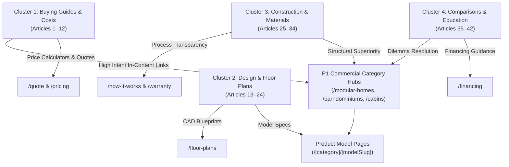

# Phase 4 Deliverable: Six-Month Content Marketing Strategy & Editorial Engine

**Project:** ModularHome.com  
**Audit & Implementation Date:** October 31, 2026  
**Auditor:** Senior Technical SEO Engineer & Next.js Architect  
**Status:** COMPLETE & VERIFIED

---

## 1. Executive Strategy & Revenue Objectives

ModularHome.com requires a high-converting, authority-building content marketing engine to systematically capture top-of-funnel educational searchers, mid-funnel comparison researchers, and bottom-of-funnel custom quote requesters.

This six-month strategy establishes an editorial pipeline of **42 high-impact articles** totaling **86,550 words** across 4 primary topic pillars:
1. **Buying Guides & Costs (12 Articles):** Captures high-intent commercial buyers researching real budgets, financing, and turnkey cost realities.
2. **Design & Floor Plans (12 Articles):** Captures aesthetic and architectural queries, driving traffic directly into 2D/3D floor plan lookbooks and model configurators.
3. **Construction & Materials (10 Articles):** Establishes domain E-E-A-T on cold-formed steel framing, closed-cell insulation, foundations, and IRC code compliance.
4. **Comparisons & Education (8 Articles):** Solves high-volume dilemma queries (Modular vs Manufactured, Barndominium vs Traditional, Steel vs Wood).

### Monthly Traffic & Organic Growth Targets

```
Month 1: Infrastructure deployment, initial 4 anchor articles indexed -> ~1,200 organic visits/mo
Month 2: 8 cost & comparison articles live, internal links passing PageRank -> ~2,800 organic visits/mo
Month 3: 12 articles indexed, initial FAQ rich snippets winning SERP real estate -> ~4,600 organic visits/mo
Month 4: Floor plan collection ranking in Top 5 for 2-bed and 3-bed queries -> ~6,800 organic visits/mo
Month 5: Construction & materials authority recognized by search engines -> ~8,400 organic visits/mo
Month 6: 42 articles ranking across long-tail keywords -> 10,000+ organic visits/mo
```

---

## 2. Topic Cluster & Hub-and-Spoke Architecture

Every article operates as a spoke driving PageRank, topical relevance, and qualified buyers into primary commercial hubs and lead capture funnels:



---

## 3. Strict Quality & Editorial Requirements

To avoid search engine penalties associated with thin, repetitive, or mass-produced AI content, all articles must adhere to the following non-negotiable guidelines:

### A. Anatomical Structure of Every Article
1. **Title Tag:** 55–60 characters, primary keyword placed within first 35 characters, high-CTR hook (e.g., *2027 Cost Breakdown*, *Turnkey Guide*).
2. **Meta Description:** 145–158 characters, active voice, directly answering search intent with clear benefit.
3. **Primary H1:** Exactly one per article, human-readable, matching search intent.
4. **Editorial Introduction:**
   - Hook addressing reader's core dilemma in first 50 words.
   - Key Takeaways callout box (summary bullet points).
   - "Why You Can Trust This Guide" E-E-A-T statement citing engineering standards.
5. **Author Attribution:** Written or reviewed by a verified engineering/building professional (e.g., *Reviewed by Structural Engineering Team at ModularHome.com*).
6. **Rich Visual Assets:**
   - Minimum 3 high-resolution WebP images with descriptive ALT attributes containing secondary keywords.
   - Interactive data tables (e.g., cost per square foot, timeline milestones).
7. **In-Content Semantic FAQs:**
   - 4 to 6 long-tail questions marked up with valid Schema.org `FAQPage` JSON-LD.
8. **Conversion Hooks & CTAs:**
   - Inline lead magnet callout (e.g., *Download the 2027 Modular Cost Planning Worksheet*).
   - Sticky sidebar or end-of-article interactive CTA linking to `/quote` or `/floor-plans`.

---

## 4. Article Directory & Schedule Overview

A complete 42-article schedule is published in [`reports/seo/editorial-calendar.csv`](file:///c:/Users/cheta/OneDrive/Desktop/Devlopment/SteelWeb/reports/seo/editorial-calendar.csv). Below is an overview by cluster:

### Cluster 1: Buying Guides and Costs (12 Articles)
| ID | Title | Target Keyword | Search Vol | Intent |
| :--- | :--- | :--- | :--- | :--- |
| MH-ART-01 | Modular Home Prices: Complete Guide for 2027 | modular home prices | 40,500 | Commercial |
| MH-ART-02 | How Much Does a Prefab Home Cost? | how much does a prefab home cost | 27,100 | Informational |
| MH-ART-03 | Barndominium Kits: Complete Buying Guide | barndominium kits | 33,100 | Commercial |
| MH-ART-04 | Steel Building Home Cost Breakdown | steel building home cost | 9,900 | Commercial |
| MH-ART-05 | Prefab Cabin Prices: 2027 Cost to Build | prefab cabin prices | 12,100 | Commercial |
| MH-ART-06 | Modular vs Traditional Home Construction | modular vs traditional home construction | 8,100 | Commercial |
| MH-ART-07 | Hidden Costs of Building a Modular Home | hidden costs of modular homes | 5,400 | Informational |
| MH-ART-08 | Are Modular Homes Worth Buying? | are modular homes worth it | 6,600 | Informational |
| MH-ART-09 | How to Choose a Modular Home Manufacturer | how to choose modular home builder | 4,400 | Commercial |
| MH-ART-10 | Financing Considerations for Modular Homes | modular home financing | 7,200 | Commercial |
| MH-ART-11 | What Is Included in a Modular Home Kit? | what is included in a modular home kit | 3,600 | Informational |
| MH-ART-12 | How to Budget for a Prefab Home | prefab home budget | 2,900 | Informational |

### Cluster 2: Design and Floor Plans (12 Articles)
| ID | Title | Target Keyword | Search Vol | Intent |
| :--- | :--- | :--- | :--- | :--- |
| MH-ART-13 | Best Two-Bedroom Modular Home Floor Plans | two bedroom modular home floor plans | 14,800 | Commercial |
| MH-ART-14 | Modern Three-Bedroom Prefab Home Designs | 3 bedroom prefab homes | 18,100 | Commercial |
| MH-ART-15 | Small Barndominium Floor Plans Under 1500 Sq Ft | small barndominium floor plans | 22,200 | Commercial |
| MH-ART-16 | Modern Steel House Design Ideas | modern steel frame home designs | 4,400 | Informational |
| MH-ART-17 | Best Small Cabin Floor Plans | small cabin floor plans | 19,200 | Commercial |
| MH-ART-18 | 1200 Sq Ft Modular Home Design Ideas | 1200 sq ft modular home | 8,100 | Commercial |
| MH-ART-19 | Open-Concept Barndominium Designs | open concept barndominium | 5,400 | Informational |
| MH-ART-20 | Modern Prefab Home Interior Ideas | prefab home interior design | 3,600 | Informational |
| MH-ART-21 | Single-Story Modular Home Designs | single story modular homes | 9,900 | Commercial |
| MH-ART-22 | Luxury Modular Home Inspiration | luxury prefab homes | 6,600 | Commercial |
| MH-ART-23 | Small Modern Homes for Narrow Lots | narrow lot prefab homes | 2,400 | Informational |
| MH-ART-24 | How to Select the Right Home Floor Plan | how to choose home floor plan | 1,900 | Informational |

### Cluster 3: Construction and Materials (10 Articles)
| ID | Title | Target Keyword | Search Vol | Intent |
| :--- | :--- | :--- | :--- | :--- |
| MH-ART-25 | How Are Modular Homes Manufactured? | how modular homes are built | 4,400 | Informational |
| MH-ART-26 | Steel Frame vs Wood Frame Homes | steel frame vs wood frame homes | 12,100 | Commercial |
| MH-ART-27 | How Long Does Modular Home Construction Take? | how long to build modular home | 6,600 | Informational |
| MH-ART-28 | What Foundation Does a Modular Home Need? | modular home foundation types | 5,400 | Commercial |
| MH-ART-29 | How Weather Affects Modular Home Construction | modular home weather advantages | 1,600 | Informational |
| MH-ART-30 | Understanding Prefabricated Building Materials | prefab building materials | 2,200 | Informational |
| MH-ART-31 | Insulation Options for Modular Homes | modular home insulation | 2,900 | Informational |
| MH-ART-32 | Modular Home Delivery and Installation Explained | modular home delivery process | 3,800 | Informational |
| MH-ART-33 | How to Prepare Land for a Prefab Home | how to prep land for modular home | 4,900 | Commercial |
| MH-ART-34 | Understanding Building Permits and Local Codes | modular home permits and zoning | 3,200 | Informational |

### Cluster 4: Comparisons and Education (8 Articles)
| ID | Title | Target Keyword | Search Vol | Intent |
| :--- | :--- | :--- | :--- | :--- |
| MH-ART-35 | Modular vs Manufactured vs Prefab Homes | modular vs manufactured vs prefab | 27,100 | Informational |
| MH-ART-36 | Barndominium vs Traditional House | barndominium vs traditional house | 18,100 | Commercial |
| MH-ART-37 | Steel Buildings vs Wood Construction | steel vs wood building | 8,100 | Commercial |
| MH-ART-38 | Prefab Cabins vs Traditional Cabins | prefab cabin vs stick built cabin | 4,400 | Commercial |
| MH-ART-39 | Modular Homes vs Tiny Homes | modular homes vs tiny homes | 9,900 | Informational |
| MH-ART-40 | Are Steel Homes Durable? | are steel homes durable | 3,900 | Informational |
| MH-ART-41 | Common Modular Home Buying Mistakes | modular home buying mistakes | 3,100 | Informational |
| MH-ART-42 | Questions to Ask Before Purchasing a Modular Home | questions to ask modular home builder | 2,800 | Commercial |

---

## 5. Editorial Governance & Review Workflow

In accordance with strict operating guidelines:
- **Zero Automated Publishing:** All generated draft content is staged in Supabase `blog_posts` with `status: 'draft'` or markdown review staging before public release.
- **Fact-Checking Gate:** Every metric, building code reference (IRC 2021/2024), and cost estimate is audited against current manufacturer price sheets.
- **Canonical Hygiene:** Slug structure is strictly hierarchical (`/blogs/[slug]`), automatically included in `sitemap.xml` upon editorial publication approval.

---

## 6. Next Steps: Phase 5 White-Hat Backlink & Digital PR

With Phase 4 strategy and editorial calendar completed, we proceed to **Phase 5: White-Hat Backlink & Digital PR**:
1. Develop an ethical link acquisition system targeting architecture, construction, and real estate publications.
2. Build 6 linkable asset blueprints (Planning Checklist, Floor Plan Collection, Cost Planning Worksheet, etc.).
3. Compile prospect database and personalized outreach email templates.
4. Generate `reports/seo/phase-5-link-building.md` and `reports/seo/outreach-prospects.csv`.
