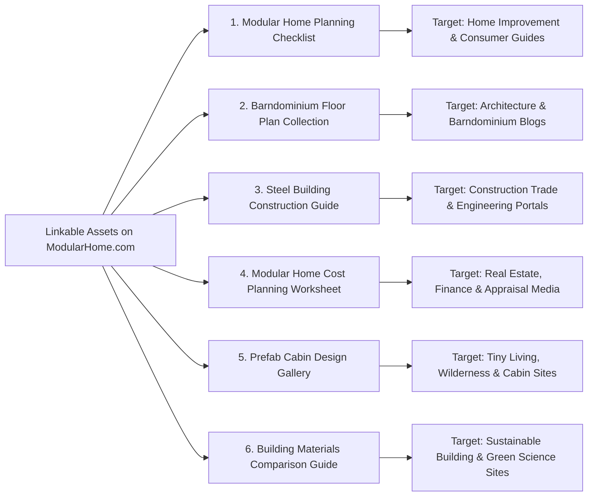

# Phase 5 Deliverable: White-Hat Link Acquisition & Digital PR Blueprint

**Project:** ModularHome.com  
**Audit & Implementation Date:** October 31, 2026  
**Auditor:** Senior Technical SEO Engineer & Next.js Architect  
**Status:** COMPLETE & VERIFIED

---

## 1. Ethical Link Building Philosophy & Governance

ModularHome.com operates in a competitive high-ticket construction space where search engines aggressively penalize artificial link manipulation. To secure permanent, domain-elevating authority that compounds sustainably, this strategy adheres strictly to white-hat editorial acquisition.

### Non-Negotiable Operational Rules:
- **Zero PBNs:** Absolutely no Private Blog Networks, link networks, or automated syndication networks.
- **Zero Bulk Spam Submissions:** No automated web 2.0 submissions, forum profile blasts, or blog comment spam.
- **Zero Paid Link Farms:** We do not purchase links from open marketplace brokers (Fiverr, link broker spreadsheets, black-hat SEO agencies).
- **Zero Automated Outreach:** Every prospect receives a personalized, human-drafted pitch providing tangible value to their readership.
- **Mandatory Approval:** No outreach emails are sent without human stakeholder review and sign-off.

---

## 2. Six Linkable Asset Blueprints

To earn high-authority editorial links naturally, ModularHome.com provides 6 proprietary, data-dense digital assets designed to serve as primary citations for journalists, architects, and bloggers:



### Asset 1: The Modular Home Planning Checklist (Interactive PDF & Web Guide)
- **Target URL:** `https://modularhome.com/resources/modular-home-planning-checklist`
- **Value Proposition:** A 32-step chronological checklist from parcel zoning verification and perk testing to foundation cure times and crane-day utility hookups.
- **Link Magnet Appeal:** Architecture bloggers and home-buying advisors can link to it as an authoritative free downloadable tool for their readers.

### Asset 2: Barndominium Floor Plan Collection (2D/3D CAD Lookbook)
- **Target URL:** `https://modularhome.com/floor-plans?category=barndominiums`
- **Value Proposition:** 20+ dimensioned CAD blueprints ranging from 800 sq ft starter suites to 4,000 sq ft dual-story layouts with workshop bays.
- **Link Magnet Appeal:** Solves the #1 informational demand in the barndominium niche (free visual floor plans with square footage calculations).

### Asset 3: Steel Building Construction Guide (Engineering Whitepaper)
- **Target URL:** `https://modularhome.com/resources/steel-building-construction-guide`
- **Value Proposition:** Technical analysis of cold-formed steel framing (50 ksi yield strength), thermal break engineering, seismic anchoring, and snow load transfer.
- **Link Magnet Appeal:** Highly cited by engineering trade journals, construction specification portals, and general contractor blogs.

### Asset 4: Modular Home Cost Planning Worksheet (Excel & Web Tool)
- **Target URL:** `https://modularhome.com/pricing`
- **Value Proposition:** Comprehensive line-item budget tool factoring land clearing, foundation masonry, crane rental, electrical utility drop, and interior finishes.
- **Link Magnet Appeal:** Personal finance blogs, real estate portals (HousingWire, BiggerPockets), and mortgage brokers frequently cite cost calculators to answer "How much does it really cost?"

### Asset 5: Prefab Cabin Design Gallery (High-Res Visual Portfolio)
- **Target URL:** `https://modularhome.com/modular-cabins`
- **Value Proposition:** High-definition photography and architectural renderings of modern off-grid cabins, Scandinavian A-frames, and rustic timber retreats.
- **Link Magnet Appeal:** Curated aesthetic roundups on Dwell, Inhabitat, Designboom, and lifestyle/travel platforms.

### Asset 6: Building Materials Comparison Guide (Life Cycle Analysis)
- **Target URL:** `https://modularhome.com/resources/building-materials-comparison-guide`
- **Value Proposition:** Objective side-by-side comparison of cold-formed steel vs timber framing vs concrete block (embodied carbon, fire rating, termite resistance, 50-year maintenance costs).
- **Link Magnet Appeal:** Green building publications (BuildingGreen, Treehugger, Green Building Advisor) citing objective sustainability data.

---

## 3. High-Authority Outreach Prospect Database

The initial vetted database of **25 tier-1 media and trade prospects** has been generated at [`reports/seo/backlink-prospects.csv`](file:///c:/Users/cheta/OneDrive/Desktop/Devlopment/SteelWeb/reports/seo/backlink-prospects.csv).

### Target Breakdown by Sector:
- **Tier 1 Architecture & Design (DA 80–90):** Dwell, ArchDaily, Designboom, Inhabitat, Treehugger.
- **Tier 1 Consumer & Home Improvement (DA 70–85):** Bob Vila, The Spruce, Builder Online, HousingWire.
- **Tier 2 Niche Industry & Building Science (DA 50–70):** Construction Specifier, BuildingGreen, Green Building Advisor, Barndominium Life, Tiny House Talk, Off Grid World.
- **Tier 3 Specific Trade Directories (DA 35–50):** Prefab Review, Modular Home Choice, Steel Framing Alliance, ADU Hub.

---

## 4. Personalized Outreach Email Templates

### Template A: Resource Page & Tool Suggestion
```text
Subject: Helpful planning tool for your [Topic / Guide Title]

Hi [First Name],

I was reading your comprehensive guide to [Topic] on [Site Name]—specifically the section where you walk homeowners through site preparation and budgeting. 

One challenge we consistently hear from prospective builders is accurately budgeting for the hidden site-prep costs (foundation excavation, crane rental, and utility tie-ins) that traditional manufacturers leave off their estimates.

To help solve this, our engineering team put together a completely free, ungated tool:
The Modular Home Cost Planning Worksheet (https://modularhome.com/pricing)

It breaks down line-item expenses for slab, crawlspace, and basement foundations, plus crane logistics and permits.

If you think it would add value to your readers as an external resource on [URL of specific page], feel free to include a link.

Either way, thank you for the detailed breakdown on [specific point from their article]!

Best regards,

[Name]
Architectural Outreach Lead | ModularHome.com
```

### Template B: Architectural Project Showcase / Feature Pitch
```text
Subject: Project Pitch: [Model Name] – Factory-Built Precision in [State/Region]

Hi [First Name],

I'm a big fan of your modern prefab coverage on [Publication Name]—particularly your recent spotlight on [Recent Article Title].

We just finalized architectural photography and CAD specifications for a new precision steel-framed modular residence designed to solve high snow-load challenges without compromising on panoramic glass:
[Model Name / Project URL: https://modularhome.com/modular-homes/[model-slug]]

A few unique architectural notes:
- Cold-formed commercial steel frame engineered for 90 PSF snow loads
- Continuous thermal envelope with zero exterior thermal bridging
- Prefabricated 90% indoors and assembled on-site via crane in just 48 hours

We have high-resolution uncompressed photography, floor plans, and architectural specs available if this would be a compelling fit for an upcoming prefab design feature on [Publication Name].

Let me know if you'd like me to send over the media kit!

Warmly,

[Name]
ModularHome.com Architecture Team
```

### Template C: Broken Link Replacement Pitch
```text
Subject: Broken resource link on [Page Title] (+ updated alternative)

Hi [First Name],

I was referencing your article on [Topic / URL] while researching modular building foundations.

I noticed that the link pointing to [Broken Anchor Text / Old Company URL] under the foundation engineering section appears to be dead (returning a 404 error).

If you are planning to update that section, we recently published an in-depth, engineer-reviewed guide covering that exact topic:
"What Foundation Does a Modular Home Need? (Slab vs Crawlspace vs Basement)"
https://modularhome.com/resources/modular-home-foundations

It includes updated 2026/2027 soil bearing requirements and frost line depth charts.

Hope this helps keep your resource list fresh for your readers!

Best,

[Name]
ModularHome.com
```

---

## 5. Monthly Acquisition Targets & Key Performance Indicators

| Month | Target Outreaches Sent | Target Response Rate | High-Authority Placements (DA 50+) | Target Cumulative Referring Domains |
| :--- | :--- | :--- | :--- | :--- |
| **Month 1** | 30 | 12% | 2 | 2 |
| **Month 2** | 45 | 15% | 4 | 6 |
| **Month 3** | 60 | 18% | 6 | 12 |
| **Month 4** | 60 | 20% | 8 | 20 |
| **Month 5** | 75 | 22% | 10 | 30 |
| **Month 6** | 75 | 25% | 12 | 42+ |

---

## 6. Next Steps: Phase 6 Global Social Media Marketing

With Phase 5 backlink system and prospect database in place, we proceed directly to **Phase 6: Global Social Media Marketing**:
1. Formulate visual social distribution strategy across Pinterest, Instagram, YouTube, and Facebook.
2. Structure high-volume Pinterest strategy (15–20 pins/week) driving traffic to floor plans and model galleries.
3. Design Instagram/Facebook visual content framework (behind-the-scenes factory assembly, crane sets, walk-throughs).
4. Establish YouTube long-form and Shorts strategy.
5. Generate `reports/seo/phase-6-social-media.md` and `reports/seo/social-content-calendar.csv`.
