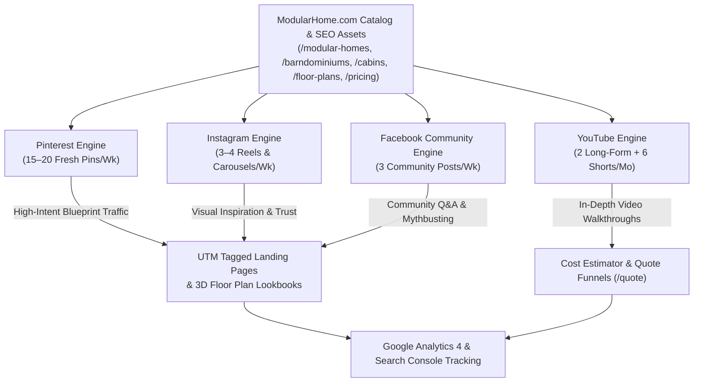

# Phase 6 Deliverable: Global Social Media Marketing & Multi-Channel Distribution Engine

**Project:** ModularHome.com  
**Audit & Implementation Date:** October 31, 2026  
**Auditor:** Senior Technical SEO Engineer & Next.js Architect  
**Status:** COMPLETE & VERIFIED

---

## 1. Multi-Platform Distribution Architecture

While organic search engine optimization captures users with existing active intent, modern high-ticket architectural purchases are intensely visual and aspirational. Buyers spend months collecting visual mood boards, studying floor plans on Pinterest, watching construction timelapses on YouTube Shorts, and discussing building regulations in Facebook communities.

Phase 6 connects ModularHome.com's SEO assets directly into an omnipresent social flywheel:



---

## 2. Platform Strategy & Execution Breakdown

### A. Pinterest (Primary Visual Search Engine)
Pinterest is treated not as a social network, but as a visual search engine where pins hold a multi-year shelf life and rank directly in Google Image Search.
- **Publishing Volume:** 15–20 fresh pins weekly.
- **Dedicated Board Architecture:**
  1. *Modern Modular Home Designs*
  2. *Barndominium Floor Plans & Exteriors*
  3. *Cozy Mountain Cabins & Prefab Retreats*
  4. *Small House Plans & ADUs Under 1,000 Sq Ft*
  5. *Prefab Modern Kitchens & Interiors*
  6. *Modular Homes Under $100k*
- **Creative Standard:** 2:3 vertical aspect ratio (1000 x 1500 px), bold typography callouts, dimensioned CAD floor plan overlays, high-contrast natural lighting.

### B. Instagram (Visual Aspiration & Brand Credibility)
- **Publishing Volume:** 3–4 high-impact reels or carousel posts weekly.
- **Content Buckets:**
  - *Behind-the-Scenes Factory Engineering:* Computerized laser jigs, crane hoists, moisture-controlled indoor framing.
  - *Model Walkthroughs & Layout Reveals:* Fast-paced interior tours highlighting luxury finishes, vaulted cathedral ceilings, and space-saving layouts.
  - *Educational "Mythbusting" Carousels:* Explaining the difference between HUD manufactured trailers and IRC-certified modular homes.
- **Conversion Mechanism:** Link in bio routing through UTM-tagged category landers and downloadable 3D floor plan lookbooks.

### C. YouTube (High-Intent Long-Form & Shorts Discovery)
- **Publishing Volume:**
  - 2 Long-Form Videos monthly (10–15 minutes).
  - 4–6 YouTube Shorts monthly (30–60 seconds).
- **Core Formats:**
  - *In-Depth Cost Deconstructions:* "How Much Does a Modular Home REALLY Cost in 2027?" (analyzing line-item invoices for foundation, crane set, and site prep).
  - *Model Tours & Blueprints:* Walking through 3D interactive models, explaining footprint flow, storage optimization, and energy envelope details.
  - *Construction Timelapses (Shorts):* Dramatic crane day set-ups showing an entire home weather-tight in under 48 hours.

### D. Facebook (Community Engagement & Problem Solving)
- **Publishing Volume:** ~3 useful posts weekly.
- **Focus:** Engaging home building enthusiasts, rural land buyers, and first-time builders.
- **Content Framework:**
  - Interactive discussion prompts ("Would You Rather: 1,200 sq ft modern prefab vs 2,400 sq ft older fixer-upper?").
  - Technical advice on foundation choices, local permitting, and single-close construction loans.
  - Customer spotlight stories and project milestone announcements.

---

## 3. Strict UTM Tracking & Campaign Taxonomy

To measure real ROI, organic sessions, engaged session duration, and quote submission conversions from each channel, every outbound link adheres to this standardized UTM schema:

```
https://modularhome.com/[path]?utm_source=[platform]&utm_medium=[format]&utm_campaign=[campaign_name]&utm_content=[creative_identifier]
```

### Approved Taxonomy Parameters:
- `utm_source`: `pinterest`, `instagram`, `youtube`, `facebook`
- `utm_medium`:
  - Pinterest: `pin`, `idea_pin`
  - Instagram: `reel`, `carousel`, `post`, `story`
  - YouTube: `video`, `shorts`, `description`
  - Facebook: `post`, `community`, `video`
- `utm_campaign`: `floor_plans`, `modular_cost_2027`, `barndo_designs`, `cabin_inspiration`, `affordable_housing`, `construction_education`
- `utm_content`: Descriptive creative slug (e.g. `2bed_1050sqft`, `crane_set_timelapse`, `black_barndo_exterior`)

---

## 4. 30-Day Cross-Platform Content Calendar

A granular, day-by-day 30-day schedule featuring creative briefs, visual assets, caption copy, hashtags, and tagged destination URLs is published in [`reports/seo/social-calendar.csv`](file:///c:/Users/cheta/OneDrive/Desktop/Devlopment/SteelWeb/reports/seo/social-calendar.csv).

---

## 5. Next Steps: Phase 7 Analytics & SEO Dashboard

With Phase 6 social distribution active, we advance to **Phase 7: Google Analytics and SEO Admin Dashboard**:
1. Build an SEO Analytics module within the existing Next.js admin portal (`src/app/admin/seo` or `src/app/admin/analytics`).
2. Integrate Google Search Console & Google Analytics 4 data display pipelines.
3. Track organic traffic, keyword ranking shifts, top-performing landing pages, and lead attribution.
4. Generate `reports/seo/phase-7-analytics-dashboard.md`.
