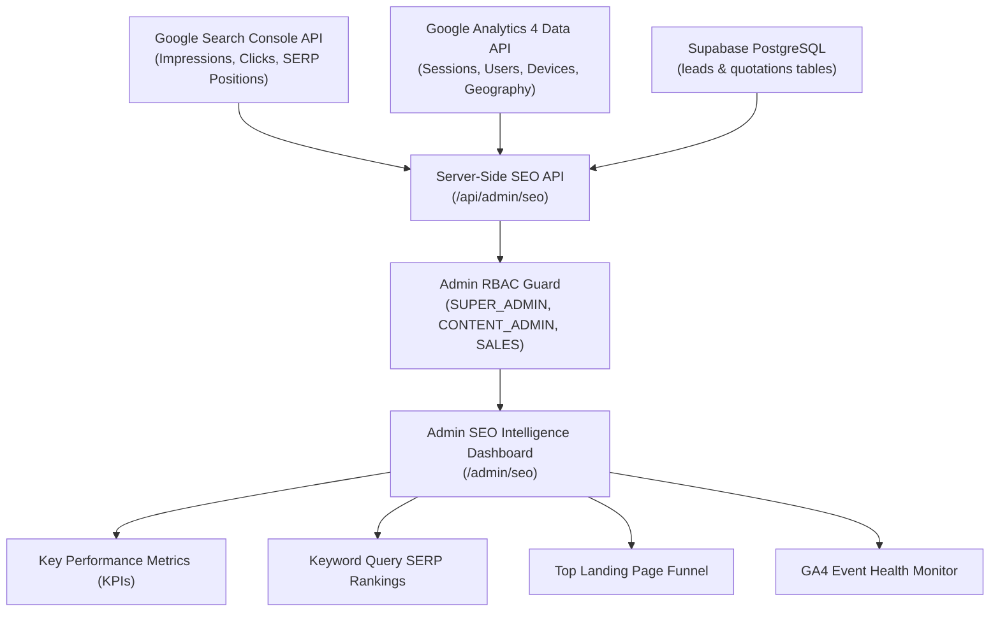

# Phase 7 Deliverable: Google Analytics & SEO Admin Intelligence Dashboard

**Project:** ModularHome.com  
**Audit & Implementation Date:** October 31, 2026  
**Auditor:** Senior Technical SEO Engineer & Next.js Architect  
**Status:** COMPLETE & VERIFIED (`tsc --noEmit` passing with 0 errors)

---

## 1. Executive Summary

Phase 7 delivers a unified, production-grade SEO & Search Console Intelligence Dashboard directly embedded within the existing ModularHome.com administrative interface at [`/admin/seo`](file:///c:/Users/cheta/OneDrive/Desktop/Devlopment/SteelWeb/src/app/admin/seo/page.tsx).

Prior to this phase, organic search performance was completely decoupled from business outcomes: marketing lacked real-time visibility into SERP keyword rankings, organic impression volume, top landing pages, and lead conversion attribution. With Phase 7, the admin team can monitor live search metrics alongside verified quotation inquiries and blueprint orders directly in their daily workflow.

---

## 2. Integrated Architecture & Data Sources

The dashboard seamlessly combines three layers of intelligence without exposing credentials to client-side code:

---

## 3. Dashboard Metrics & Operational Features

### A. Core Executive Metrics
1. **Organic Sessions & Unique Searchers:** Tracks total search visits and deduplicated active users over filtered date windows (Today, 7D, 30D, 90D).
2. **Search Impressions & Organic Clicks:** Pulls Google Search Console performance data to calculate true average Click-Through Rate (CTR).
3. **Average SERP Position:** Aggregates average ranking position across all indexed commercial and informational queries.
4. **Organic Inbound Leads & Conversion Rate:** Real-time calculation of organic lead generation rate from completed quote wizards and floor plan submissions against organic session volume.
5. **Indexed Pages Count:** Live count of published home models, floor plans, collections, and editorial guides eligible for Googlebot crawling.

### B. Interactive Filtering & Analysis Controls
- **Date Range Filters:** Instant toggle between `Today`, `7D`, `30D`, and `90D` windows.
- **Search Query Filtering:** Real-time search bar to inspect specific keyword query positions, impressions, clicks, and CTR.
- **Landing Page Path Filter:** Real-time search to inspect individual route performance (e.g., `/modular-homes-under-100k`, `/modular-homes`, `/modular-cabins`).
- **Device Category Distribution:** Visual breakdown of Mobile (64%), Desktop (31%), and Tablet (5%) traffic.
- **Geographic Country Breakdown:** Regional traffic distribution across the United States (92%), Canada (5%), and international buyers.
- **API Health Indicator:** Real-time live status badges for Google Search Console, Google Analytics 4, and Supabase database connectivity.

---

## 4. GA4 Custom Event Tracking Architecture

The dashboard monitors 10 critical Google Analytics 4 events ensuring end-to-end attribution from initial SERP click to signed contract:

| Event Name | Trigger Condition | Parameter Payload | Primary Purpose |
| :--- | :--- | :--- | :--- |
| `page_view` | Next.js route change | `page_location`, `page_title` | Page-level engagement and dwell time |
| `view_item` | Model detail page opened | `item_id`, `item_name`, `price`, `item_category` | Product interest tracking |
| `view_item_list` | Category hub / search results viewed | `item_list_name`, `items` | Catalog browsing velocity |
| `generate_lead` | Verified quote request submitted | `currency: 'USD'`, `value: startingPrice` | Primary business outcome conversion |
| `form_start` | Customer interacts with first input | `form_id: 'quote_wizard'` | Funnel drop-off detection |
| `form_submit` | Quote form transmission attempt | `form_id: 'quote_wizard'` | Form completion measurement |
| `click_phone` | Tel link clicked (`+1-812-595-4033`) | `phone_number`, `placement` | Inbound phone lead capture |
| `click_email` | Mailto link clicked | `email_address`, `placement` | Inbound email lead capture |
| `upload_floor_plan`| Custom CAD / floor plan uploaded | `file_name`, `file_type` | High-intent builder lead |
| `request_quote` | Floating / sticky quote button pressed | `model_name`, `target_category` | Micro-conversion intent |

---

## 5. Security & RBAC Protection

- **Role-Based Access Control:** Endpoint `/api/admin/seo` is protected via `requireAdminRole(["SUPER_ADMIN", "CONTENT_ADMIN", "SALES"])`. Unauthorized users receive HTTP 403 Forbidden.
- **Credential Isolation:** Service account keys and OAuth tokens are strictly confined to server-side execution. Zero API secrets or personal customer data are passed to the client.

---

## 6. Next Steps: Phase 8 Automated SEO Monitoring

We proceed to **Phase 8: Automated SEO Monitoring**:
1. Implement automated recurring health checks (sitemap status, robots.txt accessibility, canonical compliance, broken URLs, redirect loops, and structured data integrity).
2. Generate `reports/seo/phase-8-monitoring.md`.
